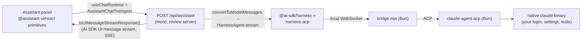

# Assistant panel (experimental POC, rr-2l7)

One native Claude Code conversation per review, in a docked **Assistant** panel. Opt-in:

```bash
bun run build && bash examples/make-demo-repo.sh .demo/demoapp
REVIEWROOM_ASSISTANT=1 bun dist/cli/reviewroom.js pr feat/activity-events --repo .demo/demoapp --dir .demo/assistant-review --no-open --port 4871
```

(`.demo/assistant-review` is a copy of `examples/activity-events`, so the checked-in example stays untouched.)

## Defaults

Use the existing machine-wide JSON settings, `~/.reviewroom/config.json` (`REVIEWROOM_HOME` overrides the root):

```json
{
  "defaultAgentHarness": "claude",
  "defaultReviewModel": "sonnet",
  "reviewAgentPromptFile": "prompts/review-agent.md"
}
```

Merge these keys with existing settings such as `publicOrigin`. An absent file or keys defaults to Claude and Sonnet.
Only `claude` is supported for now. The model is passed to the native agent as configured (an alias such as `sonnet`
or a full model ID); the agent validates availability. Invalid settings are reported rather than silently ignored.
The model default is reread before each new question, so editing it needs no restart. An active response finishes with
its existing model, including approval continuations. The configured model appears directly above the assistant's text
input (an alias is shown as configured); the idle label refreshes within two seconds. Restart for harness or prompt changes.
This does not change Claude's own settings or login. Live model discovery and effort controls remain deferred.

The optional `reviewAgentPromptFile` selects a UTF-8 Markdown file. Relative paths resolve beside `config.json`, so the
example reads `~/.reviewroom/prompts/review-agent.md`; absolute paths also work. Without this key, the packaged
`templates/assistant-prompt.md` is used. Copy that file to start customizing. A custom file replaces this default prompt;
the current review's paths, revisions and Review Room skill are appended automatically. The file is read as plain text,
without template expansion. Missing, unreadable or empty files report an error before starting the agent. Restart the
review server after editing the prompt for an existing conversation.

## Reopening a review

`assistant.json` in the review directory stores the AI SDK transcript and the harness's opaque session-resume state.
Messages retain their IDs, metadata and context chips. The file is written atomically with mode 0600, since resume state
can contain bridge credentials. Do not share or edit it. A corrupt file is reported rather than silently replaced.

On reopening the same review, assistant-ui starts with the saved messages. The first question resumes the existing native
session through `HarnessAgent.createSession({ sessionId, resumeFrom })`. Completed turns checkpoint through the harness's
`detach`/reattach APIs; graceful shutdown uses `stop()` and saves its resume state. No custom event reducer is involved.
Restarts between completed turns are tested. Recovery of a partially streamed response or a pending approval across an
abrupt termination is not established; multi-client live transcript synchronization remains deferred.

Manual trial (makes a real model call, using the existing native login):

```bash
bun scripts/assistant-trial.ts http://127.0.0.1:4873/ 'Reply briefly without tools.'
```

Live evidence: Sonnet accepted a conversation-only marker; after changing the isolated settings to Opus without restarting,
the next turn recalled it. After stopping and reopening that same review, all four earlier message IDs were preserved and
Opus recalled the marker again using the same session ID. The old browser window restored its transcript after reconnecting.

## The path, all maintained packages



The harness picks the last user message from the history as the new prompt for the native session, or continues a
paused turn when the messages end in approval responses. Text and tool assembly, streaming, Stop (request abort),
follow-up and approvals are the libraries'.

## Asking about a selection

**Ask assistant** appears in the walkthrough's block menu and the selected-text popup. The palette command *Ask the
assistant about the selection* also covers selected code lines, which have no popup. Each emits `ask-assistant`, the
same way `app.compose` emits `compose-thread`. The panel turns the selection into an `rr:` address, a description and
a short excerpt (`src/assistant/context.shared.ts`):

- Code links the displayed revision, `@<sha>` (or `@<sha>^` for a commit's parent), pinned when attached.
- The excerpt is the selected lines, read once, at most 40 lines or 4,000 characters.

That context becomes assistant-ui's **composer quote** (`setQuote`). The library owns the removable chip
(`ComposerPrimitive.Quote`/`QuoteDismiss`) and freezes the quote into the sent message's `metadata.custom.quote`, so
navigating afterwards changes nothing. The chip is Review Room's own `<rr-ref>`, with its label, icon and opening.

The server validates message metadata through `validateUIMessages({ metadataSchema })`. It accepts only an `rr:code`
or `rr:doc` address and a brief excerpt; anything else gets a 400. Only when the last message is the user's new
question does the server put the context in front of it, using the diff provider's frozen revisions and merge base
(`withContext`). Earlier history and approval continuations are untouched.

The instructions tell the agent to answer with `[label](rr:code/…#L…)`, `rr:sym/…` and `rr:doc/<id>` links, and to
link only things it has checked. A test parses every example link in the instructions.

## Model and effort: blocked upstream

`claude-agent-acp` 0.107.3 advertises `configOptions` (category `model`, and `thought_level` as `effort`) on
`session/new`, and accepts `session/set_config_option`. The pinned harness consumes these internally but never exposes
them:

- **Model:** `HarnessAgent` `model` (also per turn via `prepareCall`) goes through `modelMapping` →
  `session/set_config_option`, but the host never sees the advertised choices. The bridge reads `configOptions` only
  to check permission mappings and to resolve the current model id.
- **Effort:** no mapping exists. `permissionModeMapping` can set a config option, but only per permission mode, and
  using it for effort would be misuse.

So the panel has no model or effort control: one would need a hardcoded catalog, a second session or raw stdio. The
smallest upstream extension:

1. Expose the session's advertised config options (from `session/new`/`load`/`resume` and `config_option_update`) on
   the harness session, or as stream metadata.
2. Generalise `modelMapping` into a per-turn `sessionConfig: Record<configId, string | boolean>`. Apply it through the
   same `session/set_config_option` call as `configureACPModel`, validated against the advertised options the way
   `validateTarget` validates.

## What we own

| File | Lines | What |
| --- | --- | --- |
| `cli/lib/assistant.ts` | ~135 | session lifetime, route, attached-context check and injection, instructions (Review Room skill + review context + link contract), Bun-only glue |
| `src/assistant/context.shared.ts` | ~40 | the attached context: its address, excerpt, schema and prompt line |
| `src/assistant/thread.tsx` | ~110 | which assistant-ui primitives show, with Review Room classes; markdown through `renderMarkdown`; the quote chip |
| `src/assistant/panel.ts` | ~55 | `definePanel`, palette commands, `ask-assistant` → composer quote, lazy import of the island |
| `src/assistant/assistant.css` | ~95 | tokens only; the composer, buttons, prose and empty state are the shared ones |
| `cli/lib/assistant-agent/` | data | the native agent's `package.json` + `pnpm-lock.yaml` (claude-agent-acp 0.107.3) |

Seams elsewhere (~20 lines): the route mount and `assistant` flag in `/api/meta` (`cli/lib/server.ts`), `mountAssistant`
in `src/main.ts`, `ReviewMeta.assistant`, the `assistant` layer in `scripts/features.ts`, JSX in `tsconfig.json`,
`.tsx` in knip and `css-usage.ts`, the stylesheet and CLI externals in `scripts/build.ts`, a `--help` line.

No text accumulator, tool merger, event projector, replay reducer, custom stream protocol or scroll-follow.

## Bun only

No Node or pnpm is needed. Two process-scoped adaptations in `start()`:

- `node`: the bridge's literal `node <bridge.mjs>` launch is rewritten to this Bun. The adapter has a Node shebang;
  where Node already exists, it remains available unchanged. On a Bun-only machine, only the child launch receives
  a private `node`→Bun fallback. No global or server PATH mutation. In that fallback environment, agent commands
  naming `node` resolve to Bun; this is launcher compatibility, not a complete Node emulation.
- `pnpm`: the harness bootstrap runs `pnpm install --frozen-lockfile --prod --store-dir .pnpm-store`. Our sandbox
  session's `restricted()` views swap that exact command for `bun install --frozen-lockfile --production`, which
  migrates the pnpm lock. The install (~420 MB, once) lives in `~/.ai-sdk-harness/.harness-bootstrap/reviewroom-claude`.

Verified with a PATH holding only bun, gh and system dirs: the bridge and `claude-agent-acp` run as the Bun binary.

## Packages (exact pins)

`ai` 7.0.173, `@ai-sdk/harness` 1.0.184, `@ai-sdk/harness-acp` 1.0.124, `ai-sdk-sandbox-local` 0.1.2,
`@assistant-ui/react` 0.15.36, `@assistant-ui/ai-sdk` 0.0.18 (with `@ai-sdk/react` 4.0.177 from the lock), `react` /
`react-dom` 19.3.1. The server loads the harness packages from `node_modules` (kept out of the CLI bundle: they read
their bridge files beside their own modules); the panel is one lazy chunk (1.2 MB, 285 KB brotli), never in the entry.

## Limits

- Experimental upstream APIs; recheck on every upgrade (the `pnpm` command string above is not exported).
- Native tools stream first as `tool-input-error` ("unavailable tool") then their output: the generic ACP harness
  declares no `builtinTools`. Final state is right.
- Approvals: `permissionMode: 'allow-reads'`, so anything the native policy asks about comes to the panel as
  Allow/Deny (assistant-ui `respondToApproval`, AI SDK `sendAutomaticallyWhen`). Not seen live: this machine's native
  mode (`auto`) allowed every tool tried.
- One conversation per review, restored on reopen. No multi-tab sync, queue, attachments,
  model or effort picker (see above), phone layout or phone selection action. A fixed free port for the bridge per server. The local "sandbox" is a process runner,
  not isolation.
- Login and gateway overrides are unset for the bridge child with `env -u`; the review server's environment is
  preserved. Normal server shutdown explicitly destroys the native session and stops its process runner.
- This source-checkout POC externalizes the harness packages so their bridge assets can be read. They are currently
  devDependencies; publishing a distributable CLI requires deliberately packaging runtime dependencies/assets.
- The panel definition is registered before saved-layout restore. Closing/reopening the panel reloads its saved transcript;
  reopening the review resumes the native conversation. Unsaved composer drafts are not persisted.
