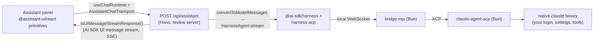

# Assistant panel (experimental POC, rr-2l7)

One native Claude Code conversation per review server, in a docked **Assistant** panel. Opt-in:

```bash
bun run build && bash examples/make-demo-repo.sh .demo/demoapp
REVIEWROOM_ASSISTANT=1 bun dist/cli/reviewroom.js pr feat/activity-events --repo .demo/demoapp --dir .demo/assistant-review --no-open --port 4871
```

(`.demo/assistant-review` is a copy of `examples/activity-events`, so the checked-in example stays untouched.)

## The path, all maintained packages



The harness picks the last user message from the history as the new prompt for the native session, or continues a
paused turn when the messages end in approval responses. Text and tool assembly, streaming, Stop (request abort),
follow-up and approvals are the libraries'.

## What we own

| File | Lines | What |
| --- | --- | --- |
| `cli/lib/assistant.ts` | ~90 | session lifetime, route, instructions (Review Room skill + review context), Bun-only glue |
| `src/assistant/thread.tsx` | ~85 | which assistant-ui primitives show, with Review Room classes; markdown through `renderMarkdown` |
| `src/assistant/panel.ts` | ~30 | `definePanel`, palette command, lazy import of the island |
| `src/assistant/assistant.css` | ~75 | tokens only; the composer, buttons, prose and empty state are the shared ones |
| `cli/lib/assistant-agent/` | data | the native agent's `package.json` + `pnpm-lock.yaml` (claude-agent-acp 0.107.3) |

Seams elsewhere (~20 lines): the route mount and `assistant` flag in `/api/meta` (`cli/lib/server.ts`), `mountAssistant`
in `src/main.ts`, `ReviewMeta.assistant`, the `assistant` layer in `scripts/features.ts`, JSX in `tsconfig.json`,
`.tsx` in knip and `css-usage.ts`, the stylesheet and CLI externals in `scripts/build.ts`, a `--help` line.

No text accumulator, tool merger, event projector, replay reducer, custom stream protocol or scroll-follow.

## Bun only

No Node or pnpm is needed. Two process-scoped adaptations, both in `start()`:

- `node`: the harness launches its bridge as the literal `node <bridge.mjs>`, and the adapter's bin is
  `#!/usr/bin/env node`. A temp dir with `node` linked to this Bun goes first on the server's PATH. Side effect: the
  agent's own commands also get Bun for `node` (`node --version` fails there).
- `pnpm`: the harness bootstrap runs `pnpm install --frozen-lockfile --prod --store-dir .pnpm-store`. Our sandbox
  session's `restricted()` views swap that exact command for `bun install --frozen-lockfile --production`, which
  migrates the pnpm lock. The install (~420 MB, once) lives in `~/.ai-sdk-harness/.harness-bootstrap/reviewroom-claude`.

Verified with a PATH holding only bun, gh and system dirs: the bridge and `claude-agent-acp` run as the Bun binary.

## Packages (exact pins)

`ai` 7.0.173, `@ai-sdk/harness` 1.0.184, `@ai-sdk/harness-acp` 1.0.124, `ai-sdk-sandbox-local` 0.1.2,
`@assistant-ui/react` 0.15.36, `@assistant-ui/ai-sdk` 0.0.18 (with `@ai-sdk/react` 4.0.177 from the lock), `react` /
`react-dom` 19.3.1. The server loads the harness packages from `node_modules` (kept out of the CLI bundle: they read
their bridge files beside their own modules); the panel is one lazy chunk (1.2 MB, 285 KB brotli), never in the entry.

## Limits

- Experimental upstream APIs; recheck on every upgrade (the `pnpm` command string above is not exported).
- Native tools stream first as `tool-input-error` ("unavailable tool") then their output: the generic ACP harness
  declares no `builtinTools`. Final state is right.
- Approvals: `permissionMode: 'allow-reads'`, so anything the native policy asks about comes to the panel as
  Allow/Deny (assistant-ui `respondToApproval`, AI SDK `sendAutomaticallyWhen`). Not seen live: this machine's native
  mode (`auto`) allowed every tool tried.
- One conversation per server process, lost on restart. No reload replay, multi-tab sync, queue, attachments,
  model picker or phone layout. A fixed free port for the bridge per server. The local "sandbox" is a process runner,
  not isolation.
- Login and gateway overrides (`ANTHROPIC_*`, `CLAUDE_CODE_*`, `CLAUDECODE`) are removed from the server's env when the
  assistant starts, so the native subscription login is used.
