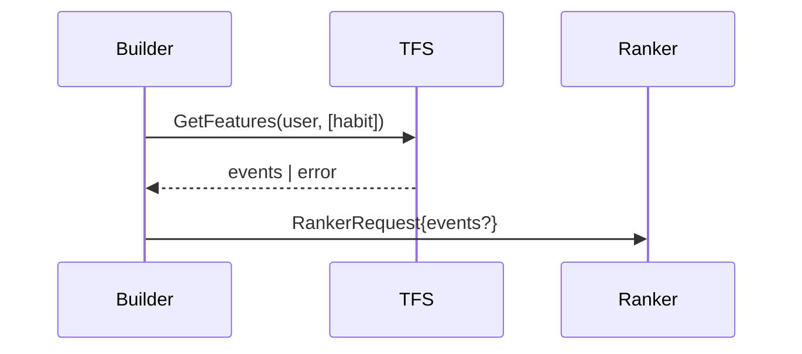
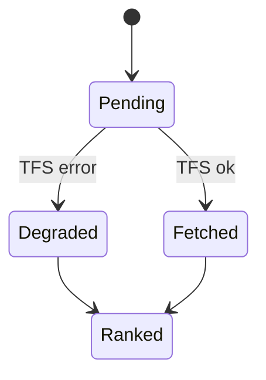
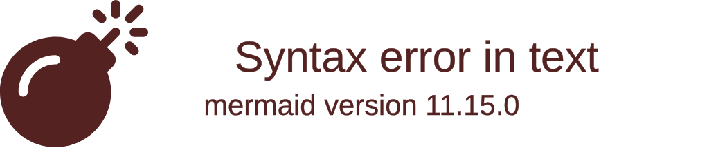
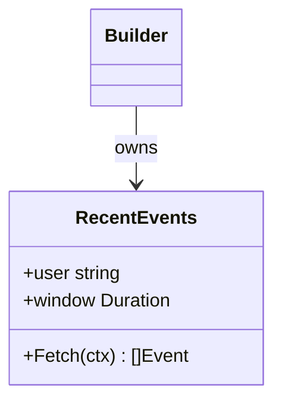
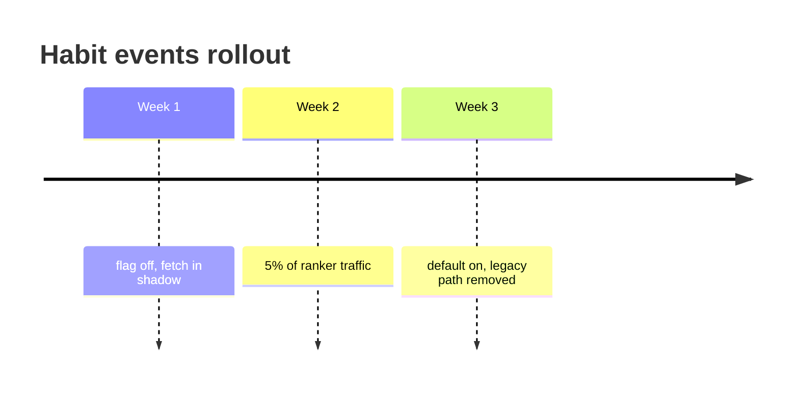

# Pictures for a walkthrough: which one, and in what

A walkthrough needs pictures (see "Show it, then say it" in `review-craft.md`). This file is the menu:
first the question the picture answers, then the smallest shape that answers it. Pick one or two
per walkthrough, not the catalog. Replace every illustrative label with a name from the diff, and give
each node a link to its code.

## Three ways to draw, all first-class

| Draw it as | When | Lights up in a guided walkthrough |
|---|---|---|
| `<rr-mermaid>` (Mermaid, rendered by Pele) | Anything with nodes and edges: flows, sequences, states, trees, contracts, timelines. Fast to write, themed, clickable | yes, by node label, where the boxes have labels: flowchart, state, class, sequence, treeView, architecture. Not timeline or gitGraph |
| `<rr-flow>` | A short linear delta against the baseline, with `new` / `changed` / `removed` badges | yes (`focus` by node label) |
| Your own HTML, SVG or `<table>` | A shape neither of the above has: a byte layout, a grid of cases, a before/after of a data structure, a latency budget, a tiny widget the reviewer can poke | no (embed it with `rr:doc/`) |

Mermaid is the default because it is the cheapest, but it is not a rule: when the picture in your
head is not a graph, draw what it is. A table is a picture when the shape of the data is the point.
Don't force code, diffs or UI layouts into diagram labels: show the code with `<rr-code ref>`, the
diff in the pane, the UI as HTML.

## Which picture for which question

Adapted from HumanLayer's "Show Me" formats (their families: logic, calls, components, files,
interactions, data flow, states, diffs, blocks, signatures, HTML), reduced to what a reviewer asks.

| The reviewer wants to know | Draw | Mermaid |
|---|---|---|
| Who sends what, and in what order? | sequence | `sequenceDiagram` |
| Which states and transitions are allowed, and how does it recover? | state machine | `stateDiagram-v2` |
| How does data cross a boundary, and what transforms it? | data flow | `flowchart LR` with the boundary as a `subgraph` |
| What calls what, in which order? | call tree | `treeView-beta` (numbered labels) |
| Where does each responsibility live? Which files move or split? | file tree | `treeView-beta` |
| Which module or component owns the state? | component tree | `flowchart TD` with `subgraph` per owner |
| What contract are we agreeing on (types, signatures)? | class diagram next to the real signatures | `classDiagram` + `<rr-code ref>` |
| In what order do steps roll out, migrate, or expire? | timeline | `timeline` |
| How do the branches or stacked PRs relate? | branch graph | `gitGraph` |
| Which service owns each step of a path across services? | lanes | `flowchart LR` with a `subgraph` per service |
| Where does traffic split, and what share falls back? | sankey | `sankey-beta` |
| What is the service's context before this diff? | context | `architecture-beta` or `C4Context`, as a `baseline` preset |

Pele renders Mermaid 12.1 syntax and more (also `block`, `packet`, `kanban`, `mindmap`, `xychart`,
`quadrantChart`, `radar-beta`, `venn`); use them when they fit a question above.

## The delta, on any of them

A diff is not a diagram type. Mark what changed on whichever picture fits, with Mermaid classes
and the `rr-diagram-delta` preset, and say it in the label too (colour alone is not enough):

```html
<rr-mermaid class="rr-diagram-delta">
flowchart TD
  Req[FeedRequest] --> Fetch[habit.RecentEvents, new]:::added --> Rank[RankerRequest, changed]:::changed
  Req --> Old[legacy.Events, removed]:::removed
  click Fetch "rr:code/pkg/features/habit/fetcher.go#L20-28" "fetcher"
  click Rank "rr:sym/Build" "the builder"
</rr-mermaid>
```

The lines themselves stay in the pane: a `click` on each changed node takes the reviewer there.
`<rr-flow>` says the same thing for a short linear delta with its `state` badges.

## Snippets

Sequence, for a request's path (`click` is not supported on participants; link the message in prose):



State machine, for a lifecycle:



Call tree, numbered in execution order:



Contract, next to the real signature (`<rr-code ref="rr:sym/RecentEvents">` under it):



Rollout order:



## Appearance

One class on `<rr-mermaid>` picks a preset; don't restyle diagrams yourself. Presets use the `--rr-*`
tokens and follow light and dark mode.

| Class | Use for |
|---|---|
| (none) | the default: panel colours, the usual radius |
| `rr-diagram-delta` | the diff: `:::added`, `:::changed`, `:::removed` nodes get the diff colours |
| `rr-diagram-baseline` | context that already exists, quiet, like `data-baseline` blocks |
| `rr-diagram-soft` | rounded, green-tinted nodes: a happy path |
| `rr-diagram-blueprint` | strong outlines, dashed edges: a plan or a proposal |
| `rr-diagram-warm` | amber canvas: a risk, a hot path |
| `rr-diagram-square` | monochrome boxes: a data layout, a protocol |
| `rr-diagram-raised` | offset shadows: a few important boxes |
| `rr-diagram-signal` | shaded nodes, heavier connectors: a signal path |
| `rr-diagram-motion` | add to any of the above: connectors flow on hover (off under reduced motion). Not in ordinary walkthroughs |

Pele has no animation of its own (`animate: true` on an edge parses and renders static). The guided
walkthrough animates diagrams for you: the nodes a slide is about light up, the rest dim, and the
edges between lit nodes flow (in flowcharts and class diagrams). Don't add motion by hand for that.
